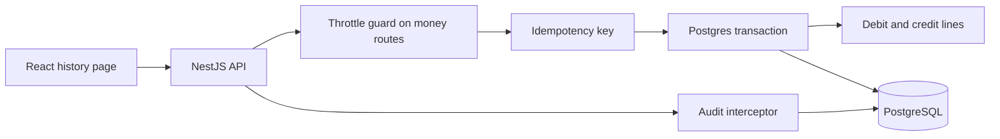

# PayLedger

PayLedger is a small digital wallet. A person can open a wallet, add funds, and send money to someone else. The balance is not stored as a number that gets updated in place. It is the running total of a double-entry ledger, so every movement can be explained line by line.

Amounts in the API are integer minor units. For USD, `1500` is $15.00.

## Features

- Open a wallet and read its balance.
- Top up a wallet. The journal debits an external funding account and credits the wallet.
- Transfer between two wallets. The journal debits the sender and credits the receiver, inside one database transaction.
- A deferred Postgres trigger rejects a commit whose debits and credits do not match.
- Top-ups and transfers take a client `Idempotency-Key`. The same key and the same body return the original journal. The same key with a different body is rejected.
- An interceptor writes an audit row for each API call (method, path, status, duration, and the idempotency key when one was sent).
- Top-up and transfer routes sit behind a throttle guard.
- Swagger UI documents the API.
- A React page lists wallets and pages through each wallet's history.

## Architecture



Wallet accounts are liabilities: a credit increases what the service owes the customer, and a debit decreases it. A top-up still balances because the external funding account is debited for the same amount. That funding account is allowed to carry a debit balance. A customer wallet is not allowed to go negative.

Two transfers that touch the same wallets take `FOR UPDATE` locks in account-id order, so they cannot deadlock on each other.

## Layout

```
backend/src
  ledger/         balance rules, journal posting, trial balance, schema trigger
  wallets/        create, list, and paginated history
  transfers/      top-up and peer transfer
  idempotency/    client keys and replay rules
  audit/          interceptor and audit log query
  seed/           demo wallets on an empty database
frontend/src      wallet list, top-up, transfer, history table
docker-compose.yml
```

## Running locally

Copy the sample environment file. Real passwords stay out of git.

```bash
cp .env.example .env
```

### Docker Compose

```bash
docker compose up --build
```

- Web UI: http://localhost:8080
- API: http://localhost:3000
- Swagger: http://localhost:3000/docs

Postgres is published on port 5432 with the user, password, and database from `.env.example`.

### Node and a local Postgres

Create the role and databases, then install and start both apps:

```sql
CREATE USER payledger WITH PASSWORD 'payledger';
CREATE DATABASE payledger OWNER payledger;
CREATE DATABASE payledger_test OWNER payledger;
```

```bash
npm install --prefix backend
npm install --prefix frontend
npm run start:api
npm run start:web
```

The UI is at http://localhost:5173 and proxies `/api` to port 3000. On an empty database the API inserts two demo wallets, Maya Chen and Luis Ortega, through the same top-up and transfer path the API uses for live requests.

Example:

```bash
curl -s -X POST http://localhost:3000/api/wallets \
  -H 'content-type: application/json' \
  -d '{"name":"Asha Patel","email":"asha@example.com"}'

curl -s -X POST http://localhost:3000/api/top-ups \
  -H 'content-type: application/json' \
  -H 'Idempotency-Key: asha-opening-0001' \
  -d '{"walletId":"<wallet-id>","amount":5000,"memo":"cash"}'
```

Sending that top-up again with the same key returns the same journal and sets `Idempotent-Replayed: true`. The wallet is credited once.

## Tests

Unit tests cover the balance rule and the idempotency decisions. Supertest covers top-up, transfer, replay, insufficient funds, history pages, the audit log, the balance trigger, and the throttle.

```bash
npm test
```

The e2e suite expects Postgres at `localhost:5432` with the credentials in `.env.example` and a database named `payledger_test`. It drops and recreates that database's schema. It will refuse to do that if the database name does not end in `_test`.

Lint and build:

```bash
npm run lint
npm run build
```

## Design notes

- The idempotency row is inserted in the same transaction as the ledger lines. A unique violation is caught with a savepoint, so a duplicate key can replay the stored response instead of posting a second journal. If the transfer fails, the whole transaction rolls back and the key is not kept.
- The request hash is the SHA-256 of the route plus the validated fields. Extra JSON and whitespace do not change it. Replaying a key does not return a fresh balance; it returns the original response.
- The audit interceptor runs outside the ledger transaction. If the audit insert fails, the error is logged and the movement is left as it is.
- The throttle counter lives in process memory. A second API instance would keep its own counter. The limit and window come from `THROTTLE_SENSITIVE_LIMIT` and `THROTTLE_TTL_MS`.
- TypeORM synchronize is on for local use (`DB_SYNCHRONIZE=true`) so the app can boot without a migration step. Synchronize does not create triggers, so the balance trigger is applied on startup.
- There is no currency conversion. Both wallets in a transfer must use the same three-letter code. Each code has its own external funding account, and the trial balance is reported per currency.
